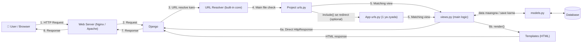
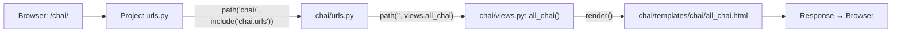
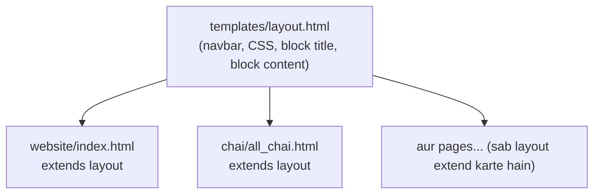

# 🐍 Django Project Setup & File Structure

> 📺 Chai aur Code: Django series, Video 2 (Start a Django project + file structure)
> 

---

## 1. Big Picture

| Cheez | Matlab |
| --- | --- |
| **Project** | Poora website/backend ka container (settings, urls, config) |
| **App** | Project ke andar ka ek feature/module (baad ke video mein) |
| **Virtual env (.venv)** | Project ke packages ko system se isolate karta hai |
| **manage.py** | Project ka command-line control panel |

---

## 2. Step-by-Step Commands + Folder Structure

### Step 1: Main folder banao

**🖥️ Terminal command**

```bash
mkdir Django
cd Django
```

```
Django/
```

### Step 2: Virtual environment banao

**🖥️ Terminal command**

```bash
python -m venv .venv
```

```
Django/
└── .venv/
    ├── Scripts/   (Linux/Mac: bin/)
    ├── Lib/
    └── pyvenv.cfg
```

> 💡 `.venv` ko **kabhi Git par push nahi karte** (`.gitignore` mein daalo).
> 

### Step 3: Virtual environment activate karo

**🖥️ Terminal command**

```bash
# Windows (CMD/PowerShell)
.venv\Scripts\activate

# Mac / Linux
source .venv/bin/activate
```

Folder structure same rehta hai; bas terminal mein `(.venv)` dikhne lagta hai.

### Step 4: Django install karo

**🖥️ Terminal command**

```bash
pip install django
```

```
Django/
└── .venv/
    └── Lib/
        └── site-packages/
            ├── django/          ← Django framework yahin install hua
            ├── asgiref/
            └── sqlparse/
```

Version check:

**🖥️ Terminal command**

```bash
python -m django --version
```

### Step 5: Django project start karo

**🖥️ Terminal command**

```bash
django-admin startproject First_Django
```

```
Django/
├── .venv/
└── First_Django/                ← Outer folder (project root)
    ├── manage.py
    └── First_Django/            ← Inner folder (project config package)
        ├── __init__.py
        ├── settings.py
        ├── urls.py
        ├── asgi.py
        └── wsgi.py
```

> 💡 **Variation:** `django-admin startproject First_Django .` (end mein dot) dene se extra outer folder nahi banta, `manage.py` seedha `Django/` ke andar aata hai.
> 

> ⚠️ **Confusion alert:** Outer aur inner dono ka naam same hota hai. Outer = container, Inner = actual Python package jisme settings hoti hain.
> 

### Step 6: Project folder ke andar jao

**🖥️ Terminal command**

```bash
cd First_Django
```

### Step 7: Server run karo

**🖥️ Terminal command**

```bash
python manage.py runserver
```

```
Django/
├── .venv/
└── First_Django/
    ├── manage.py
    └── First_Django/
        ├── __pycache__/         ← NEW (Python compiled files)
        ├── __init__.py
        ├── settings.py
        ├── urls.py
        ├── asgi.py
        └── wsgi.py
```

Browser mein kholo: `http://127.0.0.1:8000/` → rocket 🚀 wala welcome page.

> 💡 Terminal mein "You have 18 unapplied migration(s)" warning aayegi. Ye normal hai (next step).
> 

### Step 8: Migrations apply karo

**🖥️ Terminal command**

```bash
python manage.py migrate
```

```
Django/
├── .venv/
└── First_Django/
    ├── db.sqlite3               ← NEW (default database)
    ├── manage.py
    └── First_Django/
        ├── __pycache__/
        ├── __init__.py
        ├── settings.py
        ├── urls.py
        ├── asgi.py
        └── wsgi.py
```

### Step 9 (Bonus): Port change karna

**🖥️ Terminal command**

```bash
python manage.py runserver 8080
```

Server stop karne ke liye: `Ctrl + C`

---

## 3. Predefined Files: Detailed Notes

### 📄 manage.py (outer folder)

**Kya hai:** Django ka command-line utility. `django-admin` ka project-specific wrapper.

**Andar kya hota hai:**

**🐍 Python code**

```python
os.environ.setdefault('DJANGO_SETTINGS_MODULE', 'First_Django.settings')
```

Ye line Django ko batati hai ki settings file kahan hai, phir command execute karti hai.

**Kyun important:** Isi se saari commands chalti hain:

**🖥️ Terminal commands**

```bash
python manage.py runserver
python manage.py makemigrations
python manage.py migrate
python manage.py startapp <app_name>
python manage.py createsuperuser
python manage.py shell
```

> ✏️ Isse generally edit nahi karte.
> 

---

### 📄 **init**.py (inner folder)

**Kya hai:** Ek **empty file** jo folder ko Python **package** banati hai.

**Kyun important:** Iske bina Python `First_Django` ko importable package nahi samjhega (jaise `from First_Django import settings`).

---

### 📄 settings.py ⭐ (sabse important file)

**Kya hai:** Poore project ka **configuration center**. Har global setting yahin hoti hai.

| Setting | Kya karti hai |
| --- | --- |
| `BASE_DIR` | Project ka root path (`pathlib` se). Baaki paths isse bante hain |
| `SECRET_KEY` | Cryptographic signing (sessions, CSRF, password reset tokens). **Secret rakho**, GitHub par mat daalo |
| `DEBUG` | `True` = development (detailed error pages). **Production mein `False`** |
| `ALLOWED_HOSTS` | Kaun-se domains/IPs serve ho sakte hain. `DEBUG=False` par zaroori |
| `INSTALLED_APPS` | Active apps ki list (built-in + tumhare + third-party) |
| `MIDDLEWARE` | Request/response ke beech ke layers (security, sessions, CSRF, auth) |
| `ROOT_URLCONF` | Main `urls.py` ka path (`'First_Django.urls'`) |
| `TEMPLATES` | Template engine config (HTML files kahan se load hongi) |
| `WSGI_APPLICATION` | WSGI entry point ka path |
| `DATABASES` | DB config. Default = SQLite (`db.sqlite3`) |
| `AUTH_PASSWORD_VALIDATORS` | Password strength rules |
| `LANGUAGE_CODE` | Default language (`'en-us'`) |
| `TIME_ZONE` | Timezone (`'UTC'`; India ke liye `'Asia/Kolkata'`) |
| `USE_I18N` / `USE_TZ` | Internationalization / timezone-aware datetimes |
| `STATIC_URL` | CSS/JS/images serve karne ka URL prefix |
| `DEFAULT_AUTO_FIELD` | Models ke auto primary key ka type |

**🐍 Python code (example snippets)**

```python
# settings.py
INSTALLED_APPS = [
    'django.contrib.admin',
    'django.contrib.auth',
    'django.contrib.contenttypes',
    'django.contrib.sessions',
    'django.contrib.messages',
    'django.contrib.staticfiles',
    # 'myapp',   ← apna app yahan register hoga
]

TIME_ZONE = 'Asia/Kolkata'

DATABASES = {
    'default': {
        'ENGINE': 'django.db.backends.sqlite3',
        'NAME': BASE_DIR / 'db.sqlite3',
    }
}
```

> 🎯 **Interview/Exam callout:** Naya app banane ke baad `INSTALLED_APPS` mein register karna mandatory hai, warna Django usse recognize nahi karega (models, migrations, templates sab ignore).
> 

---

### 📄 urls.py (URL router)

**Kya hai:** Decide karti hai ki **kaunsa URL → kaunsa view**. Project ka "traffic police".

**🐍 Python code (default content)**

```python
from django.contrib import admin
from django.urls import path

urlpatterns = [
    path('admin/', admin.site.urls),
]
```

**🐍 Python code (custom route add karna)**

```python
from django.urls import path, include

urlpatterns = [
    path('admin/', admin.site.urls),
    path('blog/', include('blog.urls')),   # app ke URLs include
]
```

**Kyun important:** Bina URL mapping ke koi page access nahi ho sakta. Flow: `Browser → urls.py → views.py → Response`. Ye `settings.py` ke `ROOT_URLCONF` se link hoti hai.

---

### 📄 wsgi.py (Web Server Gateway Interface)

**Kya hai:** **Synchronous** web servers (Gunicorn, uWSGI, Apache mod_wsgi) aur Django ke beech ka bridge.

**🐍 Python code**

```python
import os
from django.core.wsgi import get_wsgi_application

os.environ.setdefault('DJANGO_SETTINGS_MODULE', 'First_Django.settings')
application = get_wsgi_application()
```

**Kyun important:** Production deployment mein server isi `application` object ko call karta hai. Local mein `runserver` ye khud handle karta hai.

**🖥️ Terminal command (production example)**

```bash
gunicorn First_Django.wsgi:application
```

---

### 📄 asgi.py (Asynchronous Server Gateway Interface)

**Kya hai:** WSGI ka modern, **async-capable** version. WebSockets, long-polling, async views support karta hai.

**🐍 Python code**

```python
import os
from django.core.asgi import get_asgi_application

os.environ.setdefault('DJANGO_SETTINGS_MODULE', 'First_Django.settings')
application = get_asgi_application()
```

**Kyun important:** Real-time features (chat apps, live notifications) ya async deployment ke liye. Servers: Uvicorn, Daphne, Hypercorn.

**🖥️ Terminal command (example)**

```bash
uvicorn First_Django.asgi:application
```

---

### 📄 db.sqlite3 (migrate ke baad)

**Kya hai:** Default **file-based database**. Setup-free, development ke liye perfect. **Production mein** usually PostgreSQL/MySQL (`DATABASES` change karke).

### 📁 **pycache**/

Python ki compiled `.pyc` files. Auto-generate hoti hain, inhe edit/commit nahi karte.

---

## 4. WSGI vs ASGI

| Feature | WSGI | ASGI |
| --- | --- | --- |
| Full form | Web Server Gateway Interface | Asynchronous Server Gateway Interface |
| Type | Synchronous | Sync + Async |
| WebSockets | ❌ | ✅ |
| Servers | Gunicorn, uWSGI | Uvicorn, Daphne |
| Use case | Traditional request-response | Real-time, async apps |

---

## 5. Request Flow (Mental Model)

```
Browser Request
     ↓
wsgi.py / asgi.py   (server entry point)
     ↓
Middleware          (settings.py → MIDDLEWARE)
     ↓
urls.py             (URL match)
     ↓
views.py            (logic; app mein banega)
     ↓
Template / Model → Response → Browser
```

---

## 6. Final Folder Structure (Summary)

```
Django/
├── .venv/                       ← Virtual environment
└── First_Django/                ← Project root
    ├── db.sqlite3               ← Database (after migrate)
    ├── manage.py                ← Command utility
    └── First_Django/            ← Config package
        ├── __pycache__/
        ├── __init__.py          ← Makes it a package
        ├── settings.py          ← All configuration
        ├── urls.py              ← URL routing
        ├── asgi.py              ← Async server entry
        └── wsgi.py              ← Sync server entry
```

---

## 7. Quick Revision Cheat Sheet

| Command | Type | Kaam |
| --- | --- | --- |
| `python -m venv .venv` | 🖥️ Terminal | Virtual env banata hai |
| `.venv\Scripts\activate` | 🖥️ Terminal | Env activate |
| `pip install django` | 🖥️ Terminal | Django install |
| `django-admin startproject <name>` | 🖥️ Terminal | Project banata hai |
| `python manage.py runserver` | 🖥️ Terminal | Dev server start |
| `python manage.py migrate` | 🖥️ Terminal | DB tables create/update |
| `python manage.py startapp <name>` | 🖥️ Terminal | Naya app (next video) |
| `os.environ.setdefault(...)` | 🐍 Python | Settings module point karta hai |
| `path('url/', view)` | 🐍 Python | URL route define |

---

# 🐍 Django Flow, Views, URLs, Templates & Errors

> 📺 Chai aur Code: Django series, Video 3 (Templates and errors in Django)
Isme 2 cheezein hain: (1) Django ka **request → response flow diagram**, (2) usko **code mein implement** karna: views, urls, templates, static files aur 3 common errors.
> 

---

## 1. Django Flow Diagram (Video ka diagram, clean version)

### 🗺️ Mermaid diagram (Notion mein code block language `Mermaid` rahegi to render ho jayega)



### 🖼️ Text version (agar Mermaid render na ho)

```
 ┌──────┐  Request   ┌───────────┐  Request   ┌────────┐
 │ User │ ─────────► │ Web Server│ ─────────► │ Django │
 │      │ ◄───────── │ (Nginx..) │ ◄───────── │        │
 └──────┘  Response  └───────────┘  Response  └───┬────┘
                                                  │ URL kahan jaana hai?
                                                  ▼
                                          ┌──────────────┐
                                          │ URL Resolver │  (built-in, hum nahi chhute)
                                          └──────┬───────┘
                                                 ▼
                                          ┌──────────────┐     ┌────────────────────┐
                                          │  urls.py     │ ──► │ App urls.py (many) │
                                          │  (project)   │     │ (modular routing)  │
                                          └──────┬───────┘     └─────────┬──────────┘
                                                 └──────────┬────────────┘
                                                            ▼
                         ┌─────────────┐  query/save  ┌───────────┐       ┌──────┐
                         │  views.py   │ ◄──────────► │ models.py │ ────► │  DB  │
                         │ (main logic)│              └───────────┘       └──────┘
                         └──────┬──────┘
                                │ Response
                  ┌─────────────┴─────────────┐
                  ▼                           ▼
        Direct HttpResponse            Templates (HTML)
        ("Hello World")                via render()
                  └─────────────┬─────────────┘
                                ▼
                         Django → Web Server → User
```

### 📋 Step-by-step flow (simple bhasha mein)

| # | Kya hota hai | Kaun karta hai |
| --- | --- | --- |
| 1 | User browser mein URL daalta hai (`/login`, `/about`, `/tweet/1`) | User |
| 2 | Request website ke server (Nginx/Apache etc.) se hoke Django tak aati hai | Web server |
| 3 | Django dekhta hai: **kaunsa resource** maanga gaya hai | Django |
| 4 | **URL Resolver** URL ko resolve karta hai | Django ka built-in core |
| 5 | Resolver **`urls.py`** ko dekhta hai. Ye kabhi dusri app wali `urls.py` par redirect bhi kar sakti hai | `urls.py` |
| 6 | Matching **view** (`views.py` ka function) call hota hai | `urls.py` → `views.py` |
| 7 | View logic chalata hai. Zarurat ho to `models.py` ya seedha DB se data leta/save karta hai | `views.py` |
| 8 | View **response** bhejta hai: direct `HttpResponse` ya **template** render karke | `views.py` / Templates |
| 9 | Response Django → server → browser → User | Django |

### 🧠 Key points

- Django mein flow simple hai, bas **3-4 cheezein** involved hoti hain. Isliye Django fast aur reliable maana jaata hai.
- **URL Resolver** Django ka core built-in part hai. 99% chance hai ki tum use kabhi nahi chhoge.
- `urls.py` ek hi nahi, **multiple** ho sakti hain (har app ki apni). Ye modular code hai.
- **Response hamesha view hi bhejta hai.** Template sirf HTML provide karta hai.
- View `models.py` ke through DB se baat kar sakta hai, ya direct bhi (ORM, aage aayega).
- ⚠️ **Naam fixed hote hain:** file ka naam exactly `views.py` hona chahiye (`view.py`, `myviews.py`, `chaiviews.py` nahi). Framework mein naam restricted hote hain.

> 🎯 **Interview/Exam callout:** "Request flow: Browser → Django → URL Resolver → urls.py → views.py → (models.py → DB) → Response (HttpResponse ya Template) → Browser."
> 

---

## 2. Project ka Folder Structure (shuruaat)

Pichle video ke baad:

```
Django/
├── .venv/
└── First_Django/
    ├── manage.py
    └── First_Django/
        ├── __init__.py
        ├── settings.py
        ├── urls.py
        ├── asgi.py
        └── wsgi.py
```

---

## 3. Step 1: `views.py` banao (Logic yahin likhte hain)

`views.py` ko **`urls.py` ke same level** par banao (inner `First_Django/` folder mein).

**🖥️ Terminal / editor:** inner folder mein naya file banao `views.py`

```
Django/
├── .venv/
└── First_Django/
    ├── manage.py
    └── First_Django/
        ├── __init__.py
        ├── settings.py
        ├── urls.py
        ├── views.py             ← NEW (logic yahan)
        ├── asgi.py
        └── wsgi.py
```

**🐍 Python code: `First_Django/First_Django/views.py`**

```python
from django.http import HttpResponse

def home(request):
    return HttpResponse("Hello world. You are at chai aur django home page")

def about(request):
    return HttpResponse("Hello world. You are at chai aur django about page")

def contact(request):
    return HttpResponse("Hello world. You are at chai aur django contact page")
```

### 📝 Samjho

| Cheez | Matlab |
| --- | --- |
| `HttpResponse` | Django ka class jo HTTP response banata hai. Isse Django request/response handle karne ke liye ready hota hai |
| `request` parameter | Har view function ko request milti hai. Bina iske function request handle nahi kar sakta |
| Function ka naam | **Kuch bhi** ho sakta hai (`home`, `about`, `chai_about`, `superman`). Koi restriction nahi |
| `return HttpResponse(...)` | Browser ko seedha text bhej deta hai |

> 💡 Dusri programming languages mein request/response manually parse karna padta hai. Django mein ye already handled hota hai.
> 

---

## 4. Step 2: `urls.py` mein routes jodo

**🐍 Python code: `First_Django/First_Django/urls.py`**

```python
from django.contrib import admin
from django.urls import path
from . import views            # current directory se views import

urlpatterns = [
    path('admin/', admin.site.urls),
    path('', views.home, name='home'),             # home route
    path('about/', views.about, name='about'),
    path('contact/', views.contact, name='contact'),
]
```

### 📝 Samjho

| Cheez | Matlab |
| --- | --- |
| `from . import views` | `.` = current directory. Yahan se `views.py` import ho rahi hai |
| `path('about/', views.about)` | URL `/about/` aaye to `views.about` function chalao |
| `''` (empty string) | **Home route** (`/`) |
| `name='about'` | **Optional** parameter. Route ko naam deta hai. Na do to error nahi aata. Iska use baad mein (templates mein links banate time) hoga |
| Trailing `/` | Home route ko chhodke baaki sab routes ke end mein slash likhna zaroori hai |

> 🎯 **Interview/Exam callout:** `urls.py` batata hai "kaunsa URL → kaunsa view". Bina `urls.py` mein entry ke view kabhi hit nahi hoga.
> 

---

## 5. Step 3: Server run karo aur test karo

> ⚠️ **Common mistake:** Command `manage.py` wale folder mein hi chalegi. Pehle `ls` (Windows: `dir`) karke check karo ki `manage.py` dikh rahi hai.
> 

**🖥️ Terminal commands**

```bash
cd First_Django          # manage.py wale folder mein jao
ls                       # manage.py dikhni chahiye (Windows: dir)
python manage.py runserver
```

Browser mein test karo:

| URL | Output |
| --- | --- |
| `http://127.0.0.1:8000/` | Hello world. You are at chai aur django home page |
| `http://127.0.0.1:8000/about/` | ...about page |
| `http://127.0.0.1:8000/contact/` | ...contact page |

> 💡 Terminal mein "unapplied migrations" **warning** aayegi, error nahi hai. Abhi ignore karo.
💡 Is point par: Django hit → URL resolve → `urls.py` → view → seedha response. **Template aur models abhi use nahi hue.**
> 

---

## 6. Step 4: Templates (HTML pages)

### Folders banao: `templates/` aur `static/`

Dono **root folder** mein (jahan `manage.py` hai) banao, inner `First_Django/` mein nahi.

| Folder | Kya rakhte hain |
| --- | --- |
| `templates/` | HTML files |
| `static/` | CSS, JavaScript, images (static assets) |

```
Django/
├── .venv/
└── First_Django/
    ├── manage.py
    ├── templates/               ← NEW (HTML files)
    ├── static/                  ← NEW (CSS, JS, images)
    └── First_Django/
        ├── __init__.py
        ├── settings.py
        ├── urls.py
        ├── views.py
        ├── asgi.py
        └── wsgi.py
```

### `templates/index.html` banao

File ka naam kuch bhi ho sakta hai (`index.html` zaroori nahi).

```
First_Django/
├── manage.py
├── templates/
│   └── index.html               ← NEW
├── static/
└── First_Django/
```

**🌐 HTML code: `templates/index.html`**

```html
<!DOCTYPE html>
<html lang="en">
<head>
    <meta charset="UTF-8">
    <title>Chai aur Django</title>
</head>
<body>
    <h1>Chai aur Django</h1>
</body>
</html>
```

### `views.py` mein `render()` use karo

**🐍 Python code: `views.py` (home view change)**

```python
from django.http import HttpResponse
from django.shortcuts import render      # NEW import

def home(request):
    # return HttpResponse("Hello world. You are at chai aur django home page")
    return render(request, 'index.html')  # template render karo
```

| Cheez | Matlab |
| --- | --- |
| **Render** | Template (HTML file) ko load karke HTTP response mein convert karna |
| `render(request, 'index.html')` | 1st argument request, 2nd template ka naam |

> 🤔 Sawaal: Django ko kaise pata ki `index.html` `templates` folder mein hai? Jawab: **settings.py mein bataana padta hai.** Ab ye error dekhte hain (jaanbujhke).
> 

---

## 7. ❌ Error 1: `TemplateDoesNotExist`

Home page kholne par error aata hai: **TemplateDoesNotExist at /** (`index.html`).

### 🔍 Reason

Template sahi likha, view sahi likha, par **main project ko ye bataana bhool gaye ki templates kahan se load karne hain.**

### ✅ Fix: `settings.py` → `TEMPLATES` section

**🐍 Python code: `First_Django/First_Django/settings.py`**

```python
TEMPLATES = [
    {
        'BACKEND': 'django.template.backends.django.DjangoTemplates',
        'DIRS': [BASE_DIR / 'templates'],     # ← yahan templates folder add kiya
        'APP_DIRS': True,
        'OPTIONS': {
            'context_processors': [
                'django.template.context_processors.request',
                'django.contrib.auth.context_processors.auth',
                'django.contrib.messages.context_processors.messages',
            ],
        },
    },
]
```

> 💡 Video mein yahan `DIRS` list mein templates ka path add kiya gaya (transcript is jagah thoda unclear tha). Modern Django mein `BASE_DIR / 'templates'` standard tareeka hai. `os.path.join(BASE_DIR, 'templates')` bhi chalega.
> 

Dev server khud reload ho jaata hai. Page refresh karo → **"Chai aur Django"** dikhega ✅

> 🎯 **Interview/Exam callout:** Custom `templates/` folder use karna hai to `settings.py` ke `TEMPLATES → DIRS` mein path dena **zaroori** hai.
> 

---

## 8. Templates ko subfolder mein rakhna (Error 1 dobara)

Corporate projects mein aksar `templates/<app ya website ka naam>/` structure hota hai.

**Folder:** `templates/` ke andar `website/` banao aur `index.html` usme move karo.

```
First_Django/
├── manage.py
├── templates/
│   └── website/                 ← NEW subfolder
│       └── index.html           ← MOVED yahan
├── static/
└── First_Django/
```

Ab refresh karne par **phirse `TemplateDoesNotExist`** aayega, kyunki path badal gaya.

### ✅ Fix: `views.py` mein path update karo

**🐍 Python code**

```python
def home(request):
    return render(request, 'website/index.html')   # folder/file ka path do
```

> 💡 Dono structure valid hain: (1) root pe ek `templates/` folder jisme sab apps ki files, ya (2) har app ke andar apna `templates/` folder. Company/team ke hisaab se choose hota hai.
> 

---

## 9. Static files (CSS) jodna

### `static/style.css` banao

```
First_Django/
├── manage.py
├── templates/
│   └── website/
│       └── index.html
├── static/
│   └── style.css                ← NEW
└── First_Django/
```

**🎨 CSS code: `static/style.css`** (example, colors apne hisaab se badal sakte ho)

```css
body {
    background-color: #0b1b33;   /* dark blue tone */
    color: white;
}

h1 {
    text-align: center;
    font-size: 2em;
}
```

### ❌ Try 1: Relative path (kaam nahi karta)

**🌐 HTML**

```html
<link rel="stylesheet" href="../static/style.css">
```

**Result:** CSS load nahi hoti. Terminal mein **404** (`static/style.css` not found) aata hai.

> Kyun? Browser ke liye ye URL hai, folder path nahi. Django static files ko is tarah nahi dhoondhta. Iske liye **Template Engine ki special syntax** chahiye.
> 

### 💡 Template Engine kya hai?

Template engine se HTML ke andar **programmatically code inject** kar sakte ho. Jaise purane `index.php` mein `<?php ... ?>` hota tha.

| Syntax | Matlab |
| --- | --- |
| `` | Django template **tag** (logic / keywords) |
| `` | Static asset ka sahi URL banata hai |
| `` | Template engine ko batata hai ki static tag use karenge |

### ❌ Try 2: `` bina load kiye → Error 2

**🌐 HTML**

```html
<link rel="stylesheet" href="">
```

**Error 2:** `Invalid block tag on line X: 'static'. Did you forget to register or load this tag?`

### 🔍 Reason

`static` tag use karne se pehle template engine ko batana padta hai ki static assets load karne hain.

### ✅ Fix: File ke **sabse upar** (doctype se bhi pehle) ``

**🌐 HTML code: `templates/website/index.html` (final)**

```html

<!DOCTYPE html>
<html lang="en">
<head>
    <meta charset="UTF-8">
    <title>Chai aur Django</title>
    <link rel="stylesheet" href="">
</head>
<body>
    <h1>Chai aur Django</h1>
</body>
</html>
```

Error khatam, par **CSS ab bhi apply nahi hoti** → Error 3.

---

## 10. ❌ Error 3: CSS load nahi ho rahi (404 `/static/style.css`)

### 🔍 Debugging kaise kiya?

1. Terminal mein dekha: `GET /static/style.css 404` (Not Found).
2. Browser mein **right click → View page source** kiya.
3. Dekha ki stylesheet **`/static/style.css`** se load ho rahi hai, par Django ko pata hi nahi ki `static` folder kahan hai.

### 🔍 Reason

`STATIC_URL` to defined tha, par Django ko **physical `static/` folder ka location nahi bataya.**

### ✅ Fix: `settings.py` mein `STATICFILES_DIRS` add karo

**Step A: File ke top par `os` import karo**

```python
import os
from pathlib import Path
```

(Library pehle se available hai, install nahi karni.)

**Step B: `STATIC_URL` ke bilkul neeche `STATICFILES_DIRS` likho**

```python
STATIC_URL = 'static/'

STATICFILES_DIRS = [
    os.path.join(BASE_DIR, 'static'),
]
```

> 💡 `BASE_DIR / 'static'` bhi same kaam karta hai (modern tareeka).
> 

| Cheez | Matlab |
| --- | --- |
| `STATIC_URL` | Browser mein static files ka URL prefix (`/static/...`) |
| `STATICFILES_DIRS` | **List** of folders jahan Django static files dhoondhega |
| `BASE_DIR` | Project ka root. Isi se path join hota hai |

> ⚠️ Spelling dhyan se: **`STATICFILES_DIRS`** (FILES + DIRS, dono plural, sab capital). Instructor khud bhi docs mein dekhte hain.
💡 **Best practice:** Settings related cheezein related section mein hi likho (`STATIC_URL` ke paas), file ke end mein nahi. Effect same hota hai, par dusre developers wahin dhoondhte hain.
> 

Refresh karo → ab **CSS apply** ho gayi ✅

---

## 11. Final Folder Structure

```
Django/
├── .venv/
└── First_Django/
    ├── db.sqlite3
    ├── manage.py
    ├── templates/
    │   └── website/
    │       └── index.html       ← , 
    ├── static/
    │   └── style.css            ← CSS (JS / images bhi yahin)
    └── First_Django/
        ├── __pycache__/
        ├── __init__.py
        ├── settings.py          ← TEMPLATES DIRS + STATICFILES_DIRS
        ├── urls.py              ← routes (home, about, contact)
        ├── views.py             ← home, about, contact functions
        ├── asgi.py
        └── wsgi.py
```

---

## 12. 🐞 Errors Cheat Sheet (sabse important)

| # | Error | Reason | Fix |
| --- | --- | --- | --- |
| 1 | `TemplateDoesNotExist` | Django ko nahi pata templates kahan hain, ya `render()` mein path galat | `settings.py` → `TEMPLATES → 'DIRS'` mein folder add karo. Subfolder ho to `render(request, 'website/index.html')` |
| 2 | `Invalid block tag: 'static'. Did you forget to register or load this tag?` | `` nahi likha | HTML file ke top par `` |
| 3 | CSS load nahi hoti, terminal mein `404 /static/style.css` | Django ko `static/` folder ka location nahi pata | `settings.py` mein `STATICFILES_DIRS = [os.path.join(BASE_DIR, 'static')]` |
| 4 | `manage.py` nahi mil rahi / command fail | Galat folder mein ho | `ls`/`dir` karke `manage.py` wale folder mein jao |
| 5 | View hit nahi ho raha | `views.py` ka naam galat ya `urls.py` mein route missing | File ka naam exactly `views.py`; `urls.py` mein `path()` add karo |

> 🧠 **Instructor ki seekh:** Error ko **aankh band karke fix mat karo.** Samjho exactly kya problem hai, uske peeche reason kya hai, phir solve karo. Isi se acche programmer bante hain.
> 

---

## 13. Quick Revision Cheat Sheet

| Cheez | Type | Kaam |
| --- | --- | --- |
| `from django.http import HttpResponse` | 🐍 Python | Direct text/HTTP response bhejne ke liye |
| `from django.shortcuts import render` | 🐍 Python | Template render karne ke liye |
| `render(request, 'file.html')` | 🐍 Python | HTML template ko response banata hai |
| `path('about/', views.about, name='about')` | 🐍 Python | URL → view mapping (`name` optional) |
| `from . import views` | 🐍 Python | Same folder se `views.py` import |
| `'DIRS': [BASE_DIR / 'templates']` | 🐍 Python (settings) | Template folder register |
| `STATICFILES_DIRS = [...]` | 🐍 Python (settings) | Static folder register |
| `python manage.py runserver` | 🖥️ Terminal | Dev server start (manage.py wale folder mein) |
| `` | 🌐 Template | Static tag enable (file ke top par) |
| `` | 🌐 Template | Static file ka sahi URL |

---

# 🐍 Django Apps, URL Include & Template Inheritance (Layout)

> 📺 Chai aur Code: Django series, Video 4 (playlist index 4)
Topics: Django Template Language (Jinja jaisa syntax), VS Code Django extension, `startapp`, app register karna, app-level `urls.py` + `include()`, templates app ke andar, `layout.html` + `extends` + `block`.
> 

---

## 1. Big Picture

| Cheez | Matlab |
| --- | --- |
| **Project** | Ek hi baar banta hai (`startproject`). Settings, main urls yahan hain |
| **App** | Project ke andar ka ek standalone feature (blog, auth, chai, orders...). **Multiple** ho sakti hain (`startapp`) |
| **Template engine** | HTML ke andar variables, loops, logic inject karne ka system |
| **Layout / Base template** | Ek common HTML skeleton (navbar, footer, CSS) jo baaki pages reuse karte hain |

> 🧠 Production Django projects mein **kam se kam ek app** hamesha hoti hai. Project ke default `settings.py` mein ya bahut zyada kaam nahi karte, har kaam alag app mein hota hai.
> 

---

## 2. Template Engine: Jinja / DTL

### ⚠️ Ek zaroori clarification

Video mein bola gaya ki Django mein Jinja default hota hai. **Official Django docs ke hisaab se default engine DTL (Django Template Language) hai.** Jinja2 ek optional alternative backend hai. DTL ka syntax Jinja se kaafi milta-julta hai, isliye log use "Jinja jaisa" bolte hain. Notes mein **jo syntax hai wo DTL ka hai** (video mein bhi yahi use hua).

| Cheez | Detail |
| --- | --- |
| Default engine | DTL (Django Template Language) |
| Alternative | Jinja2 (Django settings mein backend badal ke) |
| Kyun pasand | Alag extension nahi chahiye, normal HTML mein hi code inject hota hai |
| Docs | Django docs → Templates, Jinja ka official site: `jinja.palletsprojects.com` |
| Extra | Video ke description mein Hitesh sir ke blog article ka link hai (common blocks/tags ki list) |

### 📝 Syntax: sirf 2 major cheezein

| Syntax | Kab use hota hai | Example |
| --- | --- | --- |
| `{{ ... }}` | **Variable** print/inject karna | `{{ name }}` |
| `` | **Tags / logic**: load, if/else, for loop, block, extends, static, csrf_token | `` |
| `|` (pipe) | **Filters**: value ko transform karna (upper, lower, date format) | `{{ name|upper }}` |

**🌐 Template code (examples)**

```html
{{ username }}                      <!-- variable -->
{{ username|upper }}                <!-- filter (pipe) -->
                   <!-- tag -->
 Hello      <!-- if / else -->
 ...    <!-- loop -->
                    <!-- forms mein (aage aayega) -->
```

> 💡 `if/else`, `for loop`, `csrf_token` ke detail aage ke videos mein aayenge. Abhi syntax pehchanna kaafi hai.
> 

---

## 3. VS Code Setup (Django extension + Emmet)

### Step A: Django extension install karo

VS Code → Extensions → **Django** install karo. Isse snippets/boilerplate milte hain:

| Type karo | Milta hai |
| --- | --- |
| `load` → Enter | `` |
| `block` → Enter | `` |
| `extends` → Enter | `` |

### Step B: HTML file mein Emmet suggestions nahi aa rahe? (Django HTML mode)

File ka naam `.html` hote hue bhi VS Code kabhi **Django HTML** mode mein chala jaata hai. Tab `!` + Tab wale Emmet suggestions band ho jaate hain.

**Fix (VS Code settings, koi command nahi):**

1. `Ctrl + ,` (Mac: `Cmd + ,`) → Settings kholo
2. Search karo: **`Emmet: Include Languages`**
3. **Add Item** dabao
4. Item: `django-html` | Value: `html`
5. Ab Emmet suggestions wapas aayenge (`!` + Enter se HTML boilerplate)

> 💡 Instructor ne ye setting video mein kar ke dikhayi. Agar Emmet already chal raha hai to skip kar do.
> 

---

## 4. Starting Folder Structure (pichle video ke baad)

```
Django/
├── .venv/
└── First_Django/
    ├── db.sqlite3
    ├── manage.py
    ├── templates/
    │   └── website/
    │       └── index.html
    ├── static/
    │   └── style.css
    └── First_Django/
        ├── __init__.py
        ├── settings.py
        ├── urls.py
        ├── views.py
        ├── asgi.py
        └── wsgi.py
```

---

## 5. Step-by-Step: Naya App banana

### Step 1: `startapp` command chalao

> ⚠️ **Pehle check:** virtual environment active ho aur `ls` (Windows: `dir`) karne par `manage.py` dikhe. `manage.py` nahi hogi to app nahi bana paoge.
> 

**🖥️ Terminal command**

```bash
python manage.py startapp chai
```

- `startapp` = ek **nayi app ka starting point** banata hai (app ka naam `chai`).
- Ye manually folder-files banane ka shortcut hai. Pehle log manually bhi banate the.
- Ye **sirf files/folders banata hai, kuch install nahi karta.** Isliye main project ko is app ka pata nahi hota (Step 2 zaroori).

```
Django/
├── .venv/
└── First_Django/
    ├── db.sqlite3
    ├── manage.py
    ├── chai/                        ← NEW APP
    │   ├── migrations/
    │   │   └── __init__.py
    │   ├── __init__.py
    │   ├── admin.py
    │   ├── apps.py
    │   ├── models.py
    │   ├── tests.py
    │   └── views.py
    ├── templates/
    ├── static/
    └── First_Django/
```

### 📄 App ki default files

| File | Kya hai | Status abhi |
| --- | --- | --- |
| `migrations/` | DB changes ka history (aage detail mein) | Skip abhi |
| `__init__.py` | Folder ko Python package banata hai | Khaali |
| `admin.py` | Admin panel mein models register karne ke liye | Sirf import hai |
| `apps.py` | App ki configuration | Default |
| `models.py` | Database tables (models) yahan likhte hain | Aage aayega |
| `tests.py` | Testing | Abhi nahi |
| `views.py` | Is app ki logic | Khaali |

> ❗ App mein **`urls.py` nahi aati**. Wo hume khud banani padti hai (Step 5).
> 

> 🔁 `startproject` **ek hi baar** chalta hai. `startapp` jitni baar chahiye utni baar chala sakte ho (multiple apps).
> 

---

### Step 2: Main project ko app ke baare mein batao (REGISTER)

> 🧠 **Instructor ka rule:** App banane ke baad **Step 1 hamesha ye hona chahiye**: main project ko aware karwana.
> 

**🐍 Python code: `First_Django/First_Django/settings.py`**

```python
INSTALLED_APPS = [
    'django.contrib.admin',
    'django.contrib.auth',
    'django.contrib.contenttypes',
    'django.contrib.sessions',
    'django.contrib.messages',
    'django.contrib.staticfiles',
    'chai',                      # ← apni app yahan add ki
]
```

- Is list mein admin, auth, sessions, messages, staticfiles pehle se hain. Inhe **cooked-in / built-in apps** bolte hain (Django ne bana ke de diye, third-party apps bhi isi list mein aati hain).
- App ke naam ke baad **comma** lagana na bhoolo (housekeeping, error se bachata hai).

> 🎯 **Interview/Exam callout:** App banane ke baad `INSTALLED_APPS` mein register karna **mandatory** hai, warna Django usse recognize nahi karega.
> 

---

### Step 3: App ke andar templates folder banao

Do common approaches:

| Approach | Structure |
| --- | --- |
| **A (project level)** | Root `templates/chai/...` (jaisa pichle video mein) |
| **B (app level)** ✅ | `chai/templates/chai/...` (is video mein use hua) |

Approach B isliye pasand hoti hai kyunki app **standalone** ban jaati hai. Copy-paste karke kisi aur project mein daal sakte ho.

- Naya folder: `chai/templates/` (naam **exactly `templates`** hona chahiye).
- Is par koi extra setting nahi chahiye (kyunki `APP_DIRS: True` default hai).
- **Industry standard:** `templates/` ke andar **app ke naam ka ek aur folder** banate hain (`chai/templates/chai/`). Company-to-company vary kar sakta hai.
- Phir `all_chai.html` file banao (naam kuch bhi ho sakta hai).

```
First_Django/
├── manage.py
├── chai/
│   ├── migrations/
│   ├── templates/                   ← NEW
│   │   └── chai/                    ← NEW (app ke naam ka folder)
│   │       └── all_chai.html        ← NEW
│   ├── __init__.py
│   ├── admin.py
│   ├── apps.py
│   ├── models.py
│   ├── tests.py
│   └── views.py
├── templates/
│   └── website/index.html
├── static/
└── First_Django/
```

**🌐 HTML code: `chai/templates/chai/all_chai.html`** (abhi basic)

```html
<h1>All types of available chai</h1>
```

> 💡 Is point tak sirf template bana hai. Ab view → URL ka flow follow karna hai.
> 

---

### Step 4: App ki `views.py` mein view likho

**🐍 Python code: `chai/views.py`**

```python
from django.shortcuts import render

def all_chai(request):
    return render(request, 'chai/all_chai.html')
```

- `render(request, 'folder/file.html')`: pehla argument `request`, doosra template ka path (`templates/` ke baad ka).
- Path `chai/all_chai.html` hai kyunki `templates/chai/all_chai.html` banaya tha.

---

### Step 5: App ki apni `urls.py` banao

App mein `urls.py` nahi hoti, to **khud banao**. Instructor ka tareeka: main project ki `urls.py` ko pura copy karo, app ke andar `urls.py` naam se paste karo aur extra hatao.

```
chai/
├── migrations/
├── templates/chai/all_chai.html
├── __init__.py
├── admin.py
├── apps.py
├── models.py
├── tests.py
├── urls.py                          ← NEW (khud banai)
└── views.py
```

**🐍 Python code: `chai/urls.py`**

```python
from django.urls import path
from . import views            # chai ki views.py

urlpatterns = [
    path('', views.all_chai, name='all_chai'),
]
```

- `admin/` wala path **hata do** (wo main project ki zimmedari hai).
- `from . import views` ab **chai/views.py** ko point karta hai.
- `name='all_chai'` bhi do. Ye naam aage bahut kaam aayega (templates mein URL programmatically banane ke liye, jaise ``).
- Yahan `''` ka matlab: `/chai/` ke baad kuch nahi, yaani is app ka home.

---

### Step 6: Main `urls.py` se control app ko transfer karo (`include`)

**🐍 Python code: `First_Django/First_Django/urls.py`**

```python
from django.contrib import admin
from django.urls import path, include      # include add kiya
from . import views

urlpatterns = [
    path('admin/', admin.site.urls),
    path('', views.home, name='home'),
    path('about/', views.about, name='about'),
    path('contact/', views.contact, name='contact'),
    path('chai/', include('chai.urls')),   # ← control chai app ko transfer
]
```

### 📝 Samjho

| Cheez | Matlab |
| --- | --- |
| `include('chai.urls')` | "Jab `/chai/` aaye to aage ka routing `chai/urls.py` handle karega" |
| `'chai.urls'` mein `.py` **nahi** likhte | Ye Python module path hai, file ka naam nahi |
| `/chai/` ke baad ka part | App ki `urls.py` mein match hota hai |

**Example: aur routes**

```python
# chai/urls.py
urlpatterns = [
    path('', views.all_chai, name='all_chai'),        # /chai/
    path('order/', views.order, name='order'),        # /chai/order/
]
```

`chai/` pehle hi main `urls.py` ne laga diya hai, isliye app ki `urls.py` mein dobara nahi likhte.

### 🗺️ URL control transfer ka flow



```
Browser (/chai/) → Project urls.py → include('chai.urls') → chai/urls.py → chai/views.py → template → Response
```

> 🧠 **Yaad rakhne ka tareeka (instructor ka diagram):** Ek **main project `urls.py`** hoti hai, aur uske neeche **har app ki `urls.py`**. Main file control pass karti hai (include), app wali file detail handle karti hai. Pichle video ke diagram mein "Urls.py → Urls.py, Urls.py, Urls.py" yahi tha.
> 

---

### Step 7: Server chalao

**🖥️ Terminal command**

```bash
python manage.py runserver
```

| URL | Result |
| --- | --- |
| `http://127.0.0.1:8000/` | Home page (jaisa pehle tha) |
| `http://127.0.0.1:8000/chai/` | "All types of available chai" |

> 😕 Chai page **plain/feeka** dikhega (black-white), kyunki isme CSS load nahi hui. Home page mein `` + CSS tha. Ab ye **layout** se solve hoga.
> 

> 💡 Process har app ke liye **same** hai. Django 4, 5 ya aage ke versions mein ye base structure nahi badalta.
> 

---

## 6. Template Inheritance: Layout banao

### Problem

Har page mein navbar, footer, CSS, colors, title tags baar-baar likhna padega. **DRY violate.**

### Solution

Ek **base template (`layout.html`)** banao. Baaki pages isse **extend** karke sirf apna content dete hain.

### Step 8: `layout.html` banao

Root `templates/` mein banao (video mein `website/` ke bahar, same level; andar bhi bana sakte ho).

```
First_Django/
├── manage.py
├── chai/
│   └── templates/chai/all_chai.html
├── templates/
│   ├── layout.html                  ← NEW (base template)
│   └── website/
│       └── index.html
├── static/
│   └── style.css
└── First_Django/
```

**🌐 HTML code: `templates/layout.html`**

```html

<!DOCTYPE html>
<html lang="en">
<head>
    <meta charset="UTF-8">
    <meta name="viewport" content="width=device-width, initial-scale=1.0">
    <title>Chai aur Code</title>
    <link rel="stylesheet" href="">
</head>
<body>
    <nav>This is our navbar</nav>

    
    
</body>
</html>
```

### 📝 Samjho

| Cheez | Matlab |
| --- | --- |
| `` | Static tag enable (CSS ke liye). Common cheez layout mein ek hi baar |
| `...` | Ek **overridable jagah**. Beech mein likha text **default value** hai |
| `` | Page ka alag-alag content yahan aayega (default khaali) |
| Block ka naam | Kuch bhi (`title`, `content`, `superman`...). `content` bahut common hai (docs bhi yahi use karte hain) |
| Navbar | Abhi sirf text. Baad mein Bootstrap/Tailwind se achhi banegi |

> 💡 **Snippet:** VS Code mein `block` likho + Enter. `` aayega, bas naam badal do.
💡 Block **jitni baar chaho** layout mein use kar sakte ho.
> 

---

### Step 9: Pages mein `extends` use karo (override)

**🌐 `templates/website/index.html`** (purana sab delete karke)

```html


Home Page


<h1>Chai aur Code</h1>
<p>Home page</p>

```

**🌐 `chai/templates/chai/all_chai.html`**

```html


Chai Page


<h1>All chai for you</h1>

```

### 📝 Samjho

| Cheez | Matlab |
| --- | --- |
| `` | "Mai is template ko base ki tarah use kar raha hu" (Inheritance jaisa, OOP ke `extends` jaisa) |
| Block ka naam | **Layout wale naam se exactly same** hona chahiye (`title` = `title`) |
| Block diya | Layout ki default value **overwrite** ho jaati hai |
| Block nahi diya | Layout ki default value use hoti hai |
| Fayda | CSS, navbar, footer sab ek jagah. Har page mein sirf apna content |

> ✏️ **Extra tip (Django ka rule, video mein nahi):** `` child template ka **sabse pehla tag** hona chahiye. Blocks ke bahar ka content child templates mein render nahi hota.
> 

### 🗺️ Template inheritance diagram



```
              layout.html
        (navbar + CSS + blocks)
         /        |         \
  index.html  all_chai.html  aur pages
```

Ab dono pages (`/` aur `/chai/`) mein **same navbar + same CSS** milegi ✅

---

## 7. 🔍 Django Templates kahan dhoondhta hai? (Search order)

Video mein samjhaya gaya ki Django ek template dhoondhne ke liye **multiple jagah** dekhta hai (haar nahi maanta):

1. **App ke andar `templates/` folders** (`INSTALLED_APPS` ki apps)
2. **Project root ka `templates/`** (jo `settings.py` ke `TEMPLATES → DIRS` mein diya)

⚠️ **Dhyan do (accuracy):** Video mein order "pehle app, phir project root" bola gaya. Official Django docs ke hisaab se **default setup mein pehle `DIRS` (project-level folders), phir apps ke `templates/`** dekhe jaate hain. Ye farak tab dikhta hai jab **do jagah same naam ki file** ho. Isliye same file name dono jagah **mat rakho**. Isi wajah se `chai/templates/chai/...` jaisa **app ke naam wala subfolder** use hota hai.

| Rule | Detail |
| --- | --- |
| Folder ka naam | Exactly **`templates`** hona chahiye. Aur naam (jaise `my_templates`) Django search nahi karega |
| Path | `render()` / `extends` mein path `templates/` ke **baad** se likho |
| `layout.html` kahan mila? | Root `templates/` mein, isliye `` chal gaya |

---

## 8. Final Folder Structure

```
Django/
├── .venv/
└── First_Django/
    ├── db.sqlite3
    ├── manage.py
    ├── chai/                            ← APP
    │   ├── migrations/
    │   │   └── __init__.py
    │   ├── templates/
    │   │   └── chai/
    │   │       └── all_chai.html        ← extends layout.html
    │   ├── __init__.py
    │   ├── admin.py
    │   ├── apps.py
    │   ├── models.py
    │   ├── tests.py
    │   ├── urls.py                      ← app ki apni urls (khud banai)
    │   └── views.py                     ← all_chai view
    ├── templates/
    │   ├── layout.html                  ← BASE TEMPLATE (blocks)
    │   └── website/
    │       └── index.html               ← extends layout.html
    ├── static/
    │   └── style.css
    └── First_Django/
        ├── __pycache__/
        ├── __init__.py
        ├── settings.py                  ← INSTALLED_APPS mein 'chai'
        ├── urls.py                      ← include('chai.urls')
        ├── views.py                     ← home, about, contact
        ├── asgi.py
        └── wsgi.py
```

---

## 9. Sab kuch ek saath: Request flow (/chai/)

```
1. Browser → http://127.0.0.1:8000/chai/
2. Django → URL Resolver → Project urls.py
3. path('chai/', include('chai.urls'))  → control chai/urls.py ko
4. path('', views.all_chai)             → chai/views.py ka all_chai()
5. render(request, 'chai/all_chai.html')
6. all_chai.html →  → blocks fill
7. Final HTML (navbar + CSS + content) → Browser
```

---

## 10. 🐞 Errors / Gotchas Cheat Sheet

| Problem | Reason | Fix |
| --- | --- | --- |
| `startapp` ya `runserver` fail | `manage.py` wale folder mein nahi ho / venv active nahi | `ls`/`dir` check karo, venv activate karo |
| App ka kuch kaam nahi kar raha / templates nahi mil rahe | App `INSTALLED_APPS` mein register nahi | `settings.py` mein `'chai'` add karo (comma ke saath) |
| `TemplateDoesNotExist` | Folder ka naam `templates` nahi / `render()` ka path galat | Folder exactly `templates`, path `chai/all_chai.html` (templates ke baad se) |
| `/chai/` par 404 | Main `urls.py` mein `include` nahi / app mein `urls.py` nahi | `path('chai/', include('chai.urls'))` aur `chai/urls.py` banao |
| `include('chai.urls.py')` error | `.py` nahi likhte | `include('chai.urls')` |
| Block override nahi ho raha | Block ka naam layout se match nahi karta | Naam exactly same (`title` = `title`) |
| Emmet suggestions nahi aa rahe | Django HTML mode | Settings → Emmet: Include Languages → `django-html` : `html` |
| Chai page par CSS nahi | `` / `` layout mein nahi | Layout mein add karo, pages `extends` karein |

---

## 11. Quick Revision Cheat Sheet

| Command / Syntax | Type | Kaam |
| --- | --- | --- |
| `python manage.py startapp chai` | 🖥️ Terminal | Nayi app (files/folders) banata hai |
| `python manage.py runserver` | 🖥️ Terminal | Dev server start |
| `'chai'` in `INSTALLED_APPS` | 🐍 Python (settings) | App ko project mein register karna |
| `from django.urls import path, include` | 🐍 Python | `include` import |
| `path('chai/', include('chai.urls'))` | 🐍 Python | `/chai/...` ka control app ko dena |
| `path('', views.all_chai, name='all_chai')` | 🐍 Python | App ke andar route (name optional par useful) |
| `render(request, 'chai/all_chai.html')` | 🐍 Python | App ke template ko render karna |
| `{{ var }}` | 🌐 Template | Variable inject |
| `` | 🌐 Template | Logic / tags |
| `{{ var|upper }}` | 🌐 Template | Filter (pipe) |
| `` | 🌐 Template | Static tag enable |
| `...` | 🌐 Template | Overridable section (layout mein) |
| `` | 🌐 Template | Base template inherit karna |

> 🎯 **Interview/Exam callouts**
> 
> - `startproject` ek baar, `startapp` multiple baar. App banane ke baad **register** karna zaroori.
> - App ki `urls.py` **auto-generate nahi hoti**, khud banate hain, aur main `urls.py` se `include()` karte hain.
> - Template inheritance: `` + `` se code duplication bachti hai (DRY).